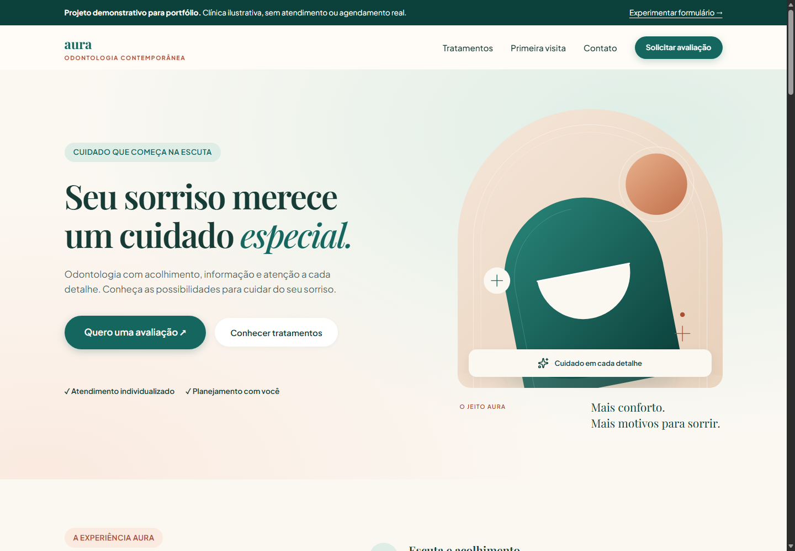
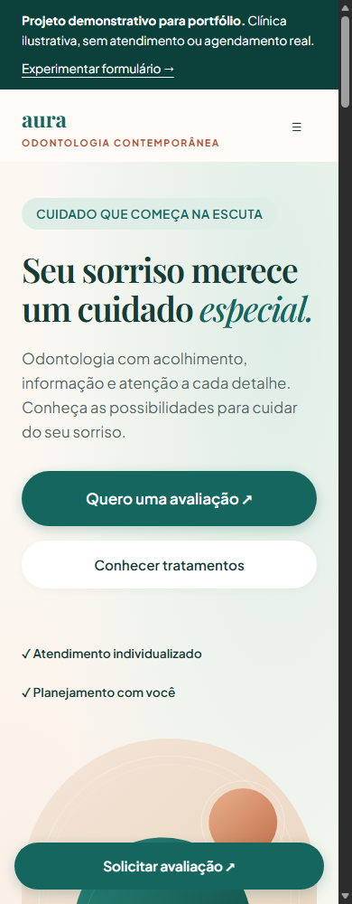

# Aura Odontologia · Projeto de portfólio

Site institucional demonstrativo de uma clínica odontológica ilustrativa, feito com **HTML, CSS e JavaScript**, com layout responsivo, recursos de acessibilidade e formulário interativo.

**Não representa uma clínica em funcionamento.** A demonstração permite preparar e copiar uma mensagem; não oferece atendimento, reservas ou envio para contatos reais. Use dados fictícios para experimentar.

[Ver demonstração online](https://arthuroliveiraa.github.io/Arthuroliveiraa/) · [Repositório](https://github.com/Arthuroliveiraa/Arthuroliveiraa) · [Como publicar](./docs/PUBLICACAO.md) · [Decisões e comparativo](./docs/COMPARATIVO.md) · [Licença MIT](./LICENSE)

[Design system visual](https://arthuroliveiraa.github.io/Arthuroliveiraa/design-system.html) · [Documentação do sistema](./docs/DESIGN_SYSTEM.md)

[](https://github.com/Arthuroliveiraa/Arthuroliveiraa/actions/workflows/check.yml)

## Prévia

### Computador



### Celular



Capturas reais da página em navegador, geradas pelos testes. O layout foi verificado em oito larguras entre 320 e 1440px.

## O que o projeto demonstra

| Área | Implementação |
| --- | --- |
| HTML | Estrutura semântica, títulos, rótulos de formulário e detalhes expansíveis nativos |
| CSS | Variáveis de design, Grid, Flexbox, fontes locais e pontos de adaptação |
| JavaScript | Eventos, filtros, validação, geração de mensagem, área de transferência e configuração |
| Acessibilidade | Atalho para conteúdo, foco visível, menu por teclado, estados ARIA e redução de movimento |
| Testes | Navegador real via CDP, dados sintéticos, cenários de erro e versão sem JavaScript |
| Entrega | Distribuição estática isolada, verificação no GitHub Actions e publicação manual no Pages |

## Funcionalidades

- Navegação para computador e celular; o menu fecha por Escape, clique externo ou saída do foco.
- Modo claro/escuro pelo botão no cabeçalho, com preferência do dispositivo na primeira visita e escolha manual salva apenas neste navegador.
- Catálogo com filtros por categoria, contagem de resultados e detalhes dos tratamentos.
- Menu com indicação da seção atual, confirmação do tratamento escolhido e detalhes ampliados para a avaliação.
- Ilustração vetorial própria, tratamentos com ícones e princípios em duas colunas.
- Galeria de ambientes conceituais com ampliação acessível, sem representar instalações reais.
- Linha do tempo da primeira visita, horizontal no computador e vertical no celular.
- Perguntas frequentes com detalhes expansíveis nativos.
- Formulário com primeira avaliação, retorno ou remarcação, tratamento e preferência de período.
- Validação do nome, revisão da mensagem, cópia com alternativa manual e limpeza dos campos.
- Modo demonstrativo que bloqueia telefone, WhatsApp e mapa, mesmo com contatos preenchidos.
- Estrutura configurável para contato, equipe e responsável técnico em uma implantação real.
- Equipe com foto e biografia, avaliações com fonte e link de agenda externa disponíveis por configuração, fora do modo demonstrativo.
- Seleção de data e horário fictícios na demonstração, sem reservas ou envio.
- Imagem PNG de compartilhamento e metadados Open Graph/Twitter estáticos.
- Informações e navegação acessíveis sem JavaScript; filtros e geração de mensagem dependem dele.

## Executar localmente

O site não exige instalação de pacotes ou compilação. Com Python 3 instalado, na pasta do projeto:

```sh
python -m http.server 8000 --bind 127.0.0.1
```

Acesse **http://127.0.0.1:8000**. Para encerrar, pressione `Ctrl+C` no terminal. Também é possível abrir [index.html](./index.html) diretamente; permissões da área de transferência variam conforme o navegador.

## Verificar o projeto

Para testes, use Node.js 22 ou superior e Edge/Chrome instalado:

```sh
node --check js/config.js
node --check js/app.js
node --check js/theme.js
node scripts/prepare-site.mjs
node tests/browser-check.mjs
```

O teste inicia um servidor em loopback e um navegador headless, executa as verificações e encerra ambos. O perfil temporário é removido ao final. Sem navegador no caminho padrão, defina `BROWSER_PATH`. Em ambientes restritos, iniciar/controlar o navegador pode exigir autorização do ambiente.

Cobertura: oito larguras de tela, IDs e âncoras, rótulos dos campos, menu, filtros, nome inválido, geração e invalidação da mensagem, limpeza, negativa de acesso ao clipboard, configuração de contatos, equipe opcional e navegação sem JavaScript. O design system também é verificado em oito larguras, com tokens compartilhados, contraste, cópia de tokens e alternativa quando a cópia é negada. As páginas não iniciam requisições externas; o modo demo não oferece contatos reais.

Para testar a distribuição pronta e atualizar as capturas no PowerShell:

```powershell
$env:AURA_SITE_ROOT = 'dist'
$env:AURA_SCREENSHOT_DIR = 'docs/images'
node tests/browser-check.mjs
```

Os workflows foram executados no GitHub Actions. A [primeira publicação validada](https://github.com/Arthuroliveiraa/Arthuroliveiraa/actions/runs/41906540970) passou nos testes e disponibilizou a demonstração em 04/11/2026. O selo acima acompanha a verificação mais recente. Esses testes não comprovam conformidade completa de acessibilidade.

## Estrutura

```text
index.html                 Página e estrutura semântica
design-system.html         Guia visual de fundamentos, componentes e padrões
css/tokens.css             Valores compartilhados entre o site e o guia
css/style.css              Design original e componentes comentados
css/fonts.css              Fontes WOFF2 locais, sem consulta a serviços externos
css/design-system.css      Apresentação exclusiva do guia visual
js/config.js               Modo de demonstração e configuração pública
js/app.js                  Interações da página
js/theme.js                Tema compartilhado, preferência local e acessibilidade
js/design-system.js        Cópia de tokens, contraste e exemplos do guia
assets/icons/favicon.svg   Ícone vetorial local
assets/illustrations/      Ilustração vetorial da abertura
assets/fonts/              Playfair Display, Plus Jakarta Sans e licenças OFL
docs/images/               Capturas usadas neste README
docs/COMPARATIVO.md         Referências, decisões e registro M01–M13
docs/PUBLICACAO.md          Passos para disponibilizar a demonstração
docs/DESIGN_SYSTEM.md       Regras, uso e manutenção do design system
docs/CONFIGURACAO.md        Mídia, equipe, avaliações e agenda externa
tests/browser-check.mjs    Verificação funcional em navegador real
scripts/prepare-site.mjs   Geração da pasta dist/ para hospedagem
.github/workflows/         Verificação e publicação no GitHub Pages
LICENSE                    Licença MIT
```

## Decisões técnicas

- **Sem framework:** a experiência cabe em uma página e interações locais, mantendo a execução simples.
- **Tipografia local:** Playfair Display e Plus Jakarta Sans em WOFF2, com variações de peso e `font-display: swap`. As fontes e os ícones são servidos pelo próprio site.
- **Melhoria progressiva:** conteúdo e elementos expansíveis nativos funcionam antes do JavaScript.
- **Configuração centralizada:** os dados públicos ficam separados da lógica e são inseridos como texto.
- **Design system compartilhado:** cores, tipografia, dimensões e efeitos ficam em `css/tokens.css`. O guia visual reutiliza os componentes do site e inclui exemplos de uso e estados.
- **Tema acessível:** site e guia alternam entre superfícies claras e escuras com tokens semânticos. Somente `aura-theme` é salvo em `localStorage`; nome, data de exemplo e mensagem não são armazenados.
- **Demonstração segura:** `demoMode: true` identifica o portfólio e bloqueia canais externos. Não são usados números, endereços ou registros profissionais fictícios como se fossem reais.
- **Publicação enxuta:** apenas HTML, CSS, JavaScript, assets e licença entram na distribuição. Testes e documentação permanecem no repositório.

A base visual fornecida no projeto foi preservada. A comparação com outros sites orientou a organização de conteúdo, documentada com referências no [comparativo](./docs/COMPARATIVO.md). Os comentários **M01 a M13** explicam cada parte e alteração.

## Limitações e evolução

O formulário monta uma mensagem no navegador. Não há backend, prontuário, autenticação ou armazenamento de pacientes. A agenda da demonstração usa datas e horários fictícios e não reserva consultas. No modo real, a disponibilidade e as reservas ficam na plataforma configurada em `booking.url`; o site oferece um link para ela. O WhatsApp continua uma alternativa de solicitação, com confirmação pela equipe.

- [x] Experiência responsiva e demonstração funcional.
- [x] Documentação, capturas, licença e testes locais.
- [x] Configuração para verificação e publicação no GitHub.
- [x] Publicar e verificar a URL real da demonstração no GitHub Pages.
- [ ] Auditoria adicional com leitores de tela e outros navegadores.
- [ ] Em uma implantação real: validar identidade, profissionais, serviços e informações de contato.
- [x] Preparar agenda demonstrativa e conexão por link com uma plataforma real.
- [ ] Para uso real: escolher o serviço de agenda, configurar sua URL e validar a disponibilidade na plataforma.

Para adaptar a uma clínica real, revise os campos de [config.js](./js/config.js), preencha os dados confirmados e altere `demoMode` para `false`. `publicationReady` remove somente o aviso de preparação no modo real; não hospeda nem publica o site.

Os tópicos 6 a 12 foram preparados em modo demonstrativo, conforme a seleção do projeto. Veja o [guia de configuração](./docs/CONFIGURACAO.md) para inserir mídia autorizada, profissionais, fontes de avaliações e o serviço de agenda. Deploy só é executado mediante solicitação explícita.

## Licença e autoria

Distribuído sob a [licença MIT](./LICENSE). Perfil do autor: [Arthur](https://github.com/Arthuroliveiraa). A marca apresentada é ilustrativa; o repositório não declara vínculo com clínicas de nome semelhante.

As fontes preservam suas licenças SIL OFL em `assets/fonts/`. Os ícones Lucide e Simple Icons preservam as respectivas licenças em `assets/icons/`.
